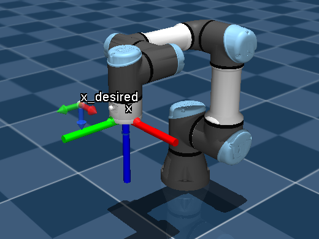
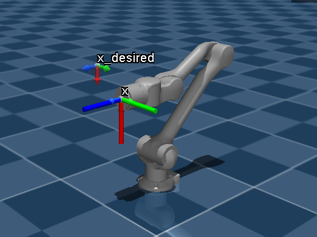
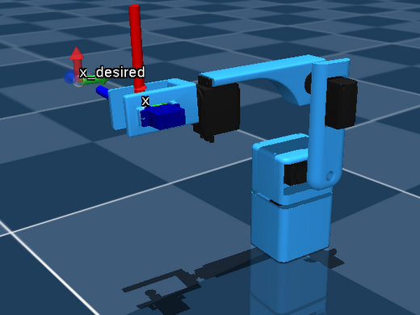

# sas_robot_driver_mujoco

A [SAS](https://smartarmstack.github.io/) robot driver for robots in [MuJoCo](https://mujoco.org) scenes, based on
[cpp-interface-mujoco](https://github.com/juanjqo/cpp-interface-mujoco). The simulation runs inside the driver, in real
time, so a robot in a MuJoCo scene has the same ROS 2 interface as a real robot with a SAS driver
(`get/joint_states`, `set/target_joint_positions`, ...).

> [!WARNING]
> This project is under active development.

| [UR3e](#example-a-ur3e) | [Unitree Z1](#example-a-unitree-z1) | [UMIRobot](#example-the-umirobot) |
|:---:|:---:|:---:|
|  |  |  |

The three examples in the window of the driver, at their home configuration, with the reference frames `x` (at the end
effector) and `x_desired` (moved through its `set/pose` topic).

## How it works

`sas::RobotDriverMujoco` is a `sas::RobotDriver` run by `sas::RobotDriverROS`:

| RobotDriver | MuJoCo |
|---|---|
| `connect()` | Loads the scene (`model_path`), opens its window (unless `headless`; with the GUI if `gui`), and adds the reference frames |
| `initialize()` | Resets the scene (to `home_keyframe`, if given) and starts the simulation in real time |
| `get_joint_positions()`, `get_joint_velocities()`, `get_joint_torques()` | The state of the joints `robot_joint_names` |
| `set_target_joint_positions()`, `set_target_joint_velocities()`, `set_target_joint_torques()` | The commands of the actuators of those joints, which must be of the kind of the command (position actuators, velocity actuators, motors) |
| `deinitialize()` | Stops the simulation |
| `disconnect()` | Closes the scene |

Shutdown uses `sas::ShutdownSignaler` (`sas_core/sas_shutdown_signaler.hpp`): a SIGINT stops the driver, and so does
closing the window of the scene. The window is checked in the control loop callback of `sas::RobotDriver`, which
`RobotDriverROS` runs at each iteration, in the thread that spins the node; the reference frames are updated there too.

## Parameters

| Parameter | | |
|---|---|---|
| `model_path` | required | The MJCF file of the scene |
| `robot_joint_names` | required | The joints of the robot, in the order of `q` |
| `joint_limits_min`, `joint_limits_max` | required | Joint limits, in degrees |
| `thread_sampling_time_sec` | required | Period of the control loop of `RobotDriverROS` |
| `home_keyframe` | optional (`""`) | Keyframe to start from (`""`: the initial state of the model) |
| `headless` | optional (`false`) | Run without a window |
| `gui` | optional (`false`) | Show the GUI of the window (see [GUI](#gui)) |
| `window_width`, `window_height` | optional (`1280`, `920`) | Size of the window, in screen coordinates |
| `reference_frame_names` | optional (none) | The reference frames (see below) |
| `reference_frames_publish_period` | optional (`0.01`) | Period of the `get/pose` topics of the reference frames, in seconds |

The node name is the prefix of the topics (e.g., `/ur3e/get/joint_states`).

## Reference frames

Reference frames are drawn in the scene, without physics (e.g., to show a desired pose), and each has a
[`sas::ObjectServer`](https://github.com/SmartArmStack/sas_common), as an object in a real setup would have:

- `/<node name>/<frame>/get/pose` (`geometry_msgs/PoseStamped`): the pose of the frame in the world, published every
  `reference_frames_publish_period`.
- `/<node name>/<frame>/set/pose` (`geometry_msgs/PoseStamped`): moves the frame (a `sas::ObjectClient`, or any
  publisher). The quaternion must be unit.

They are listed in the parameters, each with optional settings:

```yaml
reference_frame_names: ["x_desired", "x"]
reference_frames:
  x_desired:
    initial_pose: [0.2985, 0.131, 0.3033, 0.0, 0.7071, 0.7071, 0.0]  # x, y, z, qw, qx, qy, qz (default: the origin)
    axis_length: 0.1   # meters (default 0.1)
    axis_width: 0.005  # meters (default 0.005)
    opacity: 0.5       # from 0 to 1 (default 1)
    show_label: true   # (default true)
  x:
    initial_pose: [0.2985, 0.131, 0.3033, 0.0, 0.7071, 0.7071, 0.0]
```

To have no reference frames, leave out `reference_frame_names` (ROS 2 cannot read an empty list from a YAML file).

```shell
ros2 topic echo /ur3e/x_desired/get/pose
ros2 topic pub --once /ur3e/x_desired/set/pose geometry_msgs/msg/PoseStamped "{pose: {position: {x: 0.1, y: 0.2, z: 0.5}, orientation: {w: 1.0}}}"
```

## Build

Prerequisites: ROS 2 Jazzy, SAS, [DQ Robotics](https://github.com/dqrobotics/cpp), and
[cpp-interface-mujoco](https://github.com/juanjqo/cpp-interface-mujoco) 1.2 (installed; it is not a ROS package). If
cpp-interface-mujoco is not installed in a system path, add its prefix to `CMAKE_PREFIX_PATH` and `LD_LIBRARY_PATH`.

```shell
cd ~/ros2_ws/src
git clone https://github.com/MarinhoLab/sas_robot_driver_mujoco
cd ~/ros2_ws
colcon build --packages-select sas_robot_driver_mujoco && source install/setup.bash
```

## Example: a UR3e

With the UR3e of [cpp-interface-mujoco-robots](https://github.com/juanjqo/cpp-interface-mujoco-robots) (parameters in
[`config/ur3e.yaml`](config/ur3e.yaml), with two reference frames, `x_desired` and `x`, at the flange at home):

```shell
ros2 launch sas_robot_driver_mujoco robot_launch.py model_path:=<cpp-interface-mujoco-robots>/models/universal_robots_ur3e/scene.xml
```

```shell
ros2 topic echo /ur3e/get/joint_states
ros2 topic pub --once /ur3e/set/target_joint_positions std_msgs/msg/Float64MultiArray "data: [0.5, -1.2, 1.0, -0.6, -1.0, 1.0]"
```

## Example: a Unitree Z1

With the Z1 (without its gripper) of [cpp-interface-mujoco-robots](https://github.com/juanjqo/cpp-interface-mujoco-robots)
(parameters in [`config/z1.yaml`](config/z1.yaml), chosen by `name:=z1`, with two reference frames, `x_desired` and `x`,
at the flange at home):

```shell
ros2 launch sas_robot_driver_mujoco robot_launch.py name:=z1 model_path:=<cpp-interface-mujoco-robots>/models/unitree_z1/scene.xml
```

```shell
ros2 topic pub --once /z1/set/target_joint_positions std_msgs/msg/Float64MultiArray "data: [0.5, 1.2, -0.8, 0.6, 0.7, 1.0]"
ros2 topic echo /z1/get/joint_states
```

## Example: the UMIRobot

The [UMIRobot](https://mmmarinho.github.io/UMIRobot/) of Murilo M. Marinho is in this package
([`models/umirobot`](models/umirobot), installed with it), with its parameters in
[`config/umirobot.yaml`](config/umirobot.yaml), chosen by `name:=umirobot`:

```shell
ros2 launch sas_robot_driver_mujoco robot_launch.py name:=umirobot model_path:=$(ros2 pkg prefix sas_robot_driver_mujoco)/share/sas_robot_driver_mujoco/models/umirobot/scene.xml
```

```shell
ros2 topic pub --once /umirobot/set/target_joint_positions std_msgs/msg/Float64MultiArray "data: [0.5, 0.6, -0.6, 0.8, 1.0]"
```

Its joints follow the DH parameters of the UMIRobot (see its [README](models/umirobot/README.md)), so the kinematics
used with the real robot apply to the simulation.

## Launch arguments

| Argument | Default | |
|---|---|---|
| `model_path` | required | The MJCF file of the scene |
| `name` | `ur3e` | The name of the node, which is also the prefix of its topics |
| `config_file` | `config/<name>.yaml` of this package | The parameters of the robot (e.g., `config/ur3e.yaml`, `config/z1.yaml`) |
| `headless` | `false` | Run without a window |
| `gui` | `false` | Show the GUI of the window (see [GUI](#gui)) |

## GUI

With `gui:=true`, the window shows the GUI of cpp-interface-mujoco: panels around the 3D view (the bodies of the scene,
the pose of the selected body, the joints, the sensors, the visualization options), simulation controls, gizmos to move
bodies, and Ctrl + drag to push them (see its [README](https://github.com/juanjqo/cpp-interface-mujoco#gui)):

```shell
ros2 launch sas_robot_driver_mujoco robot_launch.py model_path:=<scene.xml> gui:=true
```

In the driver:

- Pause stops the simulation for the clients too: the joint states stay the same, and the commands are applied when
  it plays again.
- Reset (and Backspace) goes to the initial configuration of the model, not to `home_keyframe`; use Simulation > Reset
  to keyframe for that. The keys act whenever the window has the focus.
- The joint sliders and the gizmos move the robot only while they are dragged: then the actuators follow the commands
  of the clients again. Ctrl + drag pushes the robot, e.g., to test a controller against disturbances.

The GUI needs cpp-interface-mujoco built with it (the default); otherwise `gui:=true` stops the driver with an error.

## Docker

[`docker/Dockerfile`](docker/Dockerfile) builds an image from `murilomarinho/sas:jazzy` with the dependencies of
cpp-interface-mujoco (GLFW, OpenGL, EGL, DQ Robotics, and the current SAS packages), cpp-interface-mujoco itself (with
MuJoCo 3.16), cpp-interface-mujoco-robots (its models are in `$MUJOCO_ROBOTS_MODELS`), and this package.
[`docker/compose.yaml`](docker/compose.yaml) runs the UR3e or the Z1 example with it, on the host network, with the
window on the display of the host:

```shell
cd docker
xhost +local:root   # if the X server refuses the connection
docker compose up --build ur3e   # or z1, or scene (see below)
```

The `scene` service runs any scene of the host: the folder `SCENE_DIR` is mounted on `/scene` (with the files the scene
includes and its meshes), and the driver loads `SCENE_FILE` from it. `ROBOT_NAME` is the prefix of the topics and chooses
the parameters of the robot (`config/<ROBOT_NAME>.yaml` of this package: `ur3e`, `z1` or `umirobot`), unless
`CONFIG_FILE`, a YAML file in `SCENE_DIR`, is given. They are set in [`docker/.env`](docker/.env), which runs the
UMIRobot of this package, or in the shell:

```shell
docker compose up --build scene   # the UMIRobot (docker/.env)
SCENE_DIR=~/my_scenes SCENE_FILE=ur3e_on_a_table.xml ROBOT_NAME=ur3e docker compose up scene
```

Inside the image, the models of cpp-interface-mujoco-robots are in `/root/git/cpp-interface-mujoco-robots/models`
(`$MUJOCO_ROBOTS_MODELS`), so a scene of the host can include them with that absolute path.

The topics are reachable from the host and from other containers (e.g., `ros2 topic echo /ur3e/get/joint_states`).
Without a display, add `headless:=true` to the command of the service. `docker compose down` (or Ctrl+C on
`docker compose up`) stops the driver cleanly.

Two settings make this work, and are needed in other compose files that run the driver:
- `FASTDDS_BUILTIN_TRANSPORTS: UDPv4`: the shared memory of Fast DDS fails silently between processes of different
  users (root in the container, your user on the host), which then see the topics but not their messages.
- No `tty: true`: with a tty, `ros2 launch` does not pass the SIGINT of `docker stop` to the driver, which is then
  killed after the grace period. The image stops its containers with SIGINT (`STOPSIGNAL SIGINT`).

## License

[LGPL-3.0-or-later](LICENSE), which supplements the [GPL-3.0](COPYING), except the model of the UMIRobot
([`models/umirobot`](models/umirobot)), made from [mmmarinho/umirobot](https://github.com/mmmarinho/umirobot) and under
its license, the [GPL-3.0-or-later](models/umirobot/LICENSE), included with the permission of Murilo M. Marinho.
